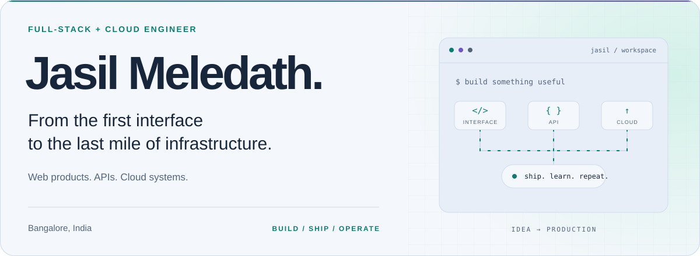
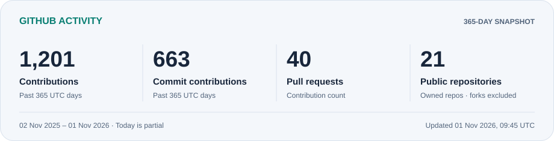
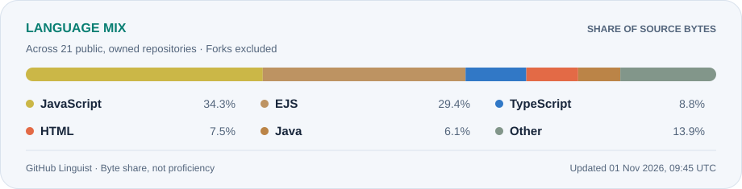

<a href="https://jasil-portfolio-nu.vercel.app/">
  <picture>
    <source media="(max-width: 600px) and (prefers-color-scheme: dark)" srcset="./assets/hero-mobile-dark.svg" />
    <source media="(max-width: 600px)" srcset="./assets/hero-mobile-light.svg" />
    <source media="(prefers-color-scheme: dark)" srcset="./assets/hero-dark.svg" />
    
  </picture>
</a>

  <a href="https://jasil-portfolio-nu.vercel.app/"><b>Explore my portfolio ↗</b></a>
  &nbsp; / &nbsp;
  <a href="https://www.linkedin.com/in/jasilmeledath">LinkedIn</a>
  &nbsp; / &nbsp;
  <a href="mailto:jasilmeledath@gmail.com">Let's talk</a>

I build **web products, backend systems, and the infrastructure behind them**. Based in Bangalore, India, I work across the whole path to production: interfaces, data models, APIs, deployment pipelines, and monitoring.

My projects span client products, open-source developer tools, and experiments with **AI and persistent memory**. I care about clear architecture, useful interfaces, and software that's practical to operate.

## Selected work

<table>
<tr>
<td width="50%" valign="top">

### 01 / Woobe
**Fashion commerce · From storefront to cloud**

Co-developed the storefront, admin, and API applications. Provisioned AWS with Terraform, built Docker delivery pipelines with health checks and rollback, and added Prometheus and Grafana monitoring.

`Next.js` `Node.js` `PostgreSQL` `Redis` `AWS` `Terraform`

[Project background ↗](https://jasil-portfolio-nu.vercel.app/#experience)

</td>
<td width="50%" valign="top">

### 02 / Picbox
**Inventory & invoicing · Built for operations**

An event-management system for rental stock, jobs, staff wages, and PDF invoices. A React Native interface backed by transactional updates and automated database backups.

`React Native` `Express` `MongoDB`

[Application ↗](https://github.com/jasilmeledath/picbox-inventory-managment-app-react-native-nodejs) · [Backend ↗](https://github.com/jasilmeledath/picboxbackend)

</td>
</tr>
<tr>
<td width="50%" valign="top">

### 03 / Uniwayin
**CRM platform · A clearer view of every lead**

A production backend for an educational consultancy: leads, follow-ups, notes, and analytics, with role-based permissions, access and refresh authentication, audit logging, and scheduled jobs.

`NestJS` `MongoDB` `REST APIs`

[Explore the API ↗](https://github.com/jasilmeledath/uniwayin-ums-api)

</td>
<td width="50%" valign="top">

### 04 / TracePanel
**Developer tooling · See the request's journey**

A live request-flow visualizer for Node.js and Express. Connects middleware, database queries, and HTTP calls using AsyncLocalStorage and OpenTelemetry, with sensitive-field redaction.

`Node.js` `Express` `OpenTelemetry`

[Source ↗](https://github.com/jasilmeledath/trace-panel-npm) · [npm ↗](https://www.npmjs.com/package/trace-panel)

</td>
</tr>
</table>

### In the lab / Persistent memory for AI

**[Ghost memory daemon ↗](https://github.com/jasilmeledath/ghost-memory-daemon)** is the memory layer behind my personal AI assistant. A Python daemon keeps Kuzu and LanceDB resident, serving graph and vector retrieval over Unix sockets.

`Python` `Kuzu` `LanceDB` `Graph + vector retrieval`

## My working stack

| Layer | Tools I work with |
| :--- | :--- |
| **Interfaces** | React · Next.js · React Native · TypeScript |
| **APIs & services** | Node.js · NestJS · Express · Fastify · Python · Java |
| **Data & jobs** | PostgreSQL · MongoDB · Redis · Prisma · BullMQ · SQL |
| **Cloud & delivery** | AWS · Docker · Terraform · GitHub Actions · Linux · Nginx |
| **Observability & AI** | Prometheus · Grafana · OpenTelemetry · LLM integrations · RAG |

## GitHub activity

<a href="https://github.com/jasilmeledath?tab=overview">
  <picture>
    <source media="(max-width: 600px) and (prefers-color-scheme: dark)" srcset="./assets/activity-mobile-dark.svg" />
    <source media="(max-width: 600px)" srcset="./assets/activity-mobile-light.svg" />
    <source media="(prefers-color-scheme: dark)" srcset="./assets/activity-dark.svg" />
    
  </picture>
</a>

Scheduled hourly from GitHub's API. These are snapshots, not a live counter; the timestamp shows the last successful refresh. [Source data](./assets/metrics.json) · [Contribution history ↗](https://github.com/jasilmeledath?tab=overview)

<b>Language mix & how the numbers are counted</b>

 

<picture>
  <source media="(max-width: 600px) and (prefers-color-scheme: dark)" srcset="./assets/languages-mobile-dark.svg" />
  <source media="(max-width: 600px)" srcset="./assets/languages-mobile-light.svg" />
  <source media="(prefers-color-scheme: dark)" srcset="./assets/languages-dark.svg" />
  
</picture>

- **Contributions** use GitHub's contribution-calendar total for the displayed 365 UTC dates. Today is partial. Commits and pull requests are breakdowns, not additional contributions to add to the total.
- **Visibility** follows the credentials used for the refresh and GitHub's contribution rules. Private activity and different date windows can make a signed-in profile differ from this card.
- **Repositories** are public, owned, and non-fork; archived repositories are included. Stars are recorded in the source data across the same set.
- **Language shares** measure repository source-code bytes, not proficiency, authorship, or time spent coding.
- **Freshness:** scheduled jobs can be delayed, and GitHub can take up to 24 hours to credit contributions. If a job fails or cannot start, the previous snapshot and its original timestamp remain. The workflow badge above links to refresh status.

---

  <b>Have something useful in mind?</b> 
  Open to collaboration on full-stack products, cloud infrastructure, and developer tools.  
  <a href="mailto:jasilmeledath@gmail.com"><b>Let's build it ↗</b></a>
  &nbsp; · &nbsp;
  <a href="https://jasil-portfolio-nu.vercel.app/">Explore my work</a>

